

<picture><source media="(prefers-color-scheme: dark)" srcset="assets/hero-dark.svg"></picture>

<picture><source media="(prefers-color-scheme: dark)" srcset="assets/social-l-dark.svg"></picture><a href="https://jaival-11.github.io/"><picture><source media="(prefers-color-scheme: dark)" srcset="assets/social-1-dark.svg"></picture></a><a href="https://x.com/techironic11"><picture><source media="(prefers-color-scheme: dark)" srcset="assets/social-2-dark.svg"></picture></a><a href="mailto:jaival7909@gmail.com "><picture><source media="(prefers-color-scheme: dark)" srcset="assets/social-3-dark.svg"></picture></a><a href="https://t.me/theironiccircle"><picture><source media="(prefers-color-scheme: dark)" srcset="assets/social-4-dark.svg"></picture></a><picture><source media="(prefers-color-scheme: dark)" srcset="assets/social-r-dark.svg"></picture>

<picture><source media="(prefers-color-scheme: dark)" srcset="assets/about-dark.svg"></picture>

<a href="https://github.com/jaival-11/Sponsor-Skip"><picture><source media="(prefers-color-scheme: dark)" srcset="assets/project-sponsor-skip-dark.svg"></picture></a>&nbsp;<a href="https://github.com/jaival-11/TeleWalls"><picture><source media="(prefers-color-scheme: dark)" srcset="assets/project-telewalls-dark.svg"></picture></a>

<a href="https://github.com/jaival-11/justalink"><picture><source media="(prefers-color-scheme: dark)" srcset="assets/project-justalink-dark.svg"></picture></a>&nbsp;<a href="https://github.com/jaival-11/lastfm-obsidian-plugin"><picture><source media="(prefers-color-scheme: dark)" srcset="assets/project-lastfm-obsidian-plugin-dark.svg"></picture></a>

<a href="https://github.com/jaival-11/Simple-File-Manager"><picture><source media="(prefers-color-scheme: dark)" srcset="assets/project-simple-file-manager-dark.svg"></picture></a>&nbsp;<a href="https://github.com/jaival-11/wa-autoforward-bot"><picture><source media="(prefers-color-scheme: dark)" srcset="assets/project-wa-autoforward-bot-dark.svg"></picture></a>

<picture><source media="(prefers-color-scheme: dark)" srcset="assets/stats-dark.svg"></picture>

<picture><source media="(prefers-color-scheme: dark)" srcset="assets/wave-dark.svg"></picture>

<a href="https://jaival-11.github.io/"><picture><source media="(prefers-color-scheme: dark)" srcset="assets/button-1-dark.svg"></picture></a>&nbsp;&nbsp;<a href="https://github.com/jaival-11?tab=repositories"><picture><source media="(prefers-color-scheme: dark)" srcset="assets/button-2-dark.svg"></picture></a>

<a href="https://metawka.github.io/expressive-profile/?from=jaival-11"><picture><source media="(prefers-color-scheme: dark)" srcset="assets/credit-dark.svg"></picture></a>

